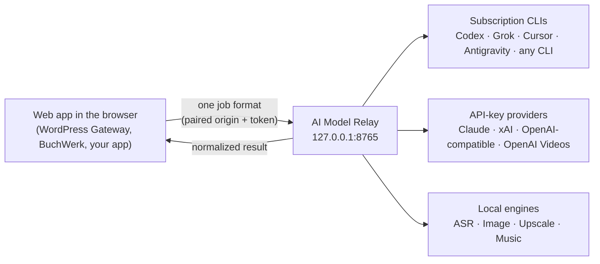
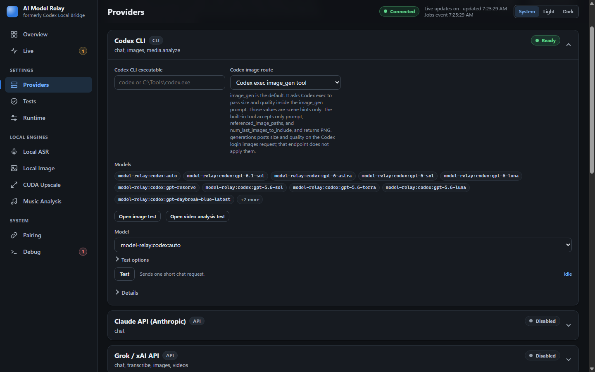
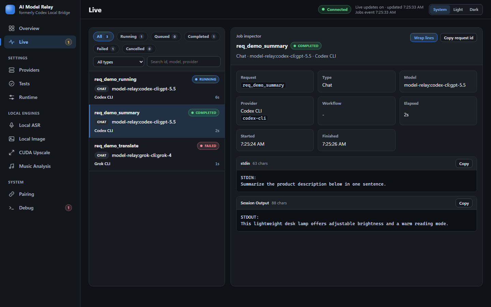

# AI Model Relay

**One local REST API for every AI model you can use: your subscription CLIs, your API keys, and models running on your own GPU.**

AI Model Relay is a small Windows tray app that runs an HTTP server on `127.0.0.1`. Web apps send chat, image, video, transcription, and media-analysis jobs to that one stable API. The Relay translates each job for the provider you picked (Codex CLI, Claude API, Grok, Cursor Agent, Antigravity, any OpenAI-compatible endpoint, or a local model) and returns the result in one normalized shape.

Change the provider on the status page, not in your application code.


## Why you need it

Every AI provider works differently. One has a REST API with its own request format, the next is only a command-line tool with its own login, the third runs locally in Python and needs a GPU. A web application that wants to offer several of them has to integrate, authenticate, and maintain each one, and has to change again whenever a provider changes its interface or a better model appears.

AI Model Relay is the layer in between:

- **One contract for all providers.** Your app always sends the same job envelope to the same routes (`/v1/relay/jobs/chat`, `/images`, `/videos`, `/transcribe`, `/media/analyze`, ...) and always gets the same response shape back. Adding or switching a provider needs no code change in the app.
- **Use the subscriptions you already pay for.** ChatGPT (through Codex CLI), Grok, Cursor, and Google Antigravity subscriptions come with command-line tools but no API that a web page can call. The Relay runs those CLIs on your machine, so a browser app can use them.
- **Bring your own API keys.** Claude API (Anthropic), Grok / xAI API, and any OpenAI-compatible `/chat/completions` endpoint can be added with a key on the status page.
- **Run models locally.** Speech recognition (Whisper, Qwen3 ASR), image generation (Qwen-Image, FLUX.2, NVIDIA Sana, Ideogram), CUDA upscaling, and music analysis run on your own hardware; that data never leaves the computer.
- **Pick the default per job type.** The **Routing** card sets which model handles chat, images, videos, transcription, and analysis. A request can still name a provider or model explicitly.
- **Predictable behavior.** The Relay never silently falls back to another provider. If the chosen one is not installed, not signed in, or cannot do the job, the request fails with a clear error naming it.
- **Secure by default.** The server listens only on `127.0.0.1`, browser origins must be paired with a code from the tray, and API keys are stored locally and never sent back to the page.

The main consumer is the [Alorbach AI Subscription Gateway](https://github.com/alorbach/alorbach-ai-subscription-gateway/) WordPress plugin, which keeps plans, quotas, and audit records on the server while the actual model runs through the Relay on the user's computer. Any other browser app on a paired origin can use the same API; see the [standalone HTTP example](examples/http-app/README.md).

## How it works



1. The web app pairs once with the Relay using the six-digit code from the tray menu and keeps a per-origin token.
2. For each job it sends a signed envelope (`job_token`, `request_hash`, `request_id`, `payload`) to the Relay. With the WordPress Gateway these values are created on the server.
3. The Relay picks the backend driver (explicit model or provider in the payload, otherwise the saved default), runs the job, and returns the normalized result.
4. The app hands the result back to its own server, which validates and records it.

## Supported providers

| Provider | How it connects | Chat | Images | Video | Media analysis | Transcription |
| --- | --- | :---: | :---: | :---: | :---: | :---: |
| **Codex CLI** | Local CLI, ChatGPT sign-in (`codex login`) | ✓ (with images) | ✓ | | ✓ | |
| **Grok CLI** | Local CLI, Grok sign-in | ✓ | ✓ ¹ | experimental ¹ | | |
| **Cursor Agent** | Local CLI (`cursor-agent`), read-only ask mode | ✓ | | | | |
| **Antigravity CLI** | Local CLI (`agy`), Google sign-in | ✓ | ✓ | | ✓ | |
| **CLI Process** | Any command-line tool, prompt on stdin | ✓ | | | | |
| **Claude API (Anthropic)** | API key | ✓ (with images) | | | | |
| **Grok / xAI API** | API key | ✓ | ✓ Imagine | ✓ Imagine | | ✓ Speech-to-Text |
| **API Key Chat** | Any OpenAI-compatible `/chat/completions` endpoint | ✓ | | | | |
| **OpenAI Videos** | API key, opt-in ² | | | ✓ | | |
| **Local ASR** | Local Python: faster-whisper, Qwen3 ASR with word timestamps | | | | | ✓ |
| **Local Image** | Local GPU: Qwen-Image, FLUX.2-dev, NVIDIA Sana, Ideogram 4.0 GGUF | | ✓ | | | |
| **Local CUDA Upscale** | Local GPU: SwinIR, Real-ESRGAN, HAT-S, DRCT, APISR (native ×2 / ×4) | | upscale | | | |
| **Local Music Analysis** | Local Python: tempo, key, loudness, sections | | | | music | |

¹ Only when the local Grok Imagine skill declares the matching tools.
² OpenAI scheduled Sora 2 and the Videos API for removal on 24 Sep 2026. The driver stays for compatibility; prefer xAI Imagine video.

The Relay only uses what is installed and configured. CLIs are found on `PATH` or at a path you set on the status page; local engines are installed only when you press their **Install** / **Setup** button.

## Quick start

1. Download the installer `.exe` or the portable `.zip` from the [latest release](https://github.com/alorbach/ai-model-relay/releases) and start **AI Model Relay**. It appears in the Windows tray.
2. Sign in to the CLIs you want to use, under the same Windows account, for example:

   ```powershell
   codex login
   ```

3. Double-click the tray icon to open the status page. Under **Providers**, press **Refresh detection**, enter any API keys you want to use, and check that the cards turn ready.
4. In the **Routing** card, choose the default model for each job type and press **Save changes**.
5. Optional: run a real request from **Tests** to confirm a provider works (tests are real requests and may cost money).
6. In your web app, keep the Relay URL `http://127.0.0.1:8765` and enter the pairing code from the tray menu when asked. To keep one code across restarts, save a fixed code on the **Pairing** page.

For the WordPress Gateway: enable **AI Gateway → Settings → Providers / Import → User-owned local Codex** and pick a relay model or the relay default. See [Gateway Integration](docs/gateway-integration.md).

## A request in one example

After pairing, a chat job looks the same for every provider; only the model ID changes:

```js
const response = await fetch('http://127.0.0.1:8765/v1/relay/jobs/chat', {
	method: 'POST',
	headers: {
		'Content-Type': 'application/json',
		'X-Alorbach-Bridge-Token': bridgeToken,
		'X-Alorbach-Request-Id': requestId,
	},
	body: JSON.stringify({
		job_token, request_hash, request_id: requestId, // from your server
		payload: {
			model: 'model-relay:anthropic:claude-sonnet-5-5', // or model-relay:codex:auto, model-relay:xai:grok-4.6, ...
			messages: [{ role: 'user', content: 'Summarize this text ...' }],
		},
	}),
});
const result = await response.json();
console.log(result.response.choices[0].message.content); // same shape for every provider
```

Leave out `model` to use the default from the Routing card. `GET /v1/relay/models` lists the available model IDs and their job types. The full reference is in [Local Bridge API](docs/local-bridge-api.md).

## Status page and tray

The tray menu shows the Relay state, the pairing code, paired sites, and running jobs, and copies diagnostics without secrets.


The status page (double-click the tray icon) is where everything is configured:

| Page | Purpose |
| --- | --- |
| **Overview** | Relay state, job counts, one tile per provider, Claude API usage. |
| **Live** | Running, queued, and recent jobs with their input, output, errors, and generated images. |
| **Providers** | One card per provider: status, executable path, API keys, models, an inline chat test. The **Routing** card sets the default model per job type and the token defaults. |
| **Tests** | Real chat, image, video, analysis, and audio requests against each ready provider. |
| **Runtime** | Timeouts and the number of parallel jobs. |
| **Local ASR**, **Local Image**, **CUDA Upscale**, **Music Analysis** | Explicit setup and settings of the local engines. |
| **Pairing**, **Debug** | Fixed pairing code; health checks, recent failures, raw status. |

| Providers (dark) | Live (dark) |
| --- | --- |
|  |  |

More on every page, local engine setup, and troubleshooting: [Operations](docs/operations.md).

## Requirements

- Windows 10 or later.
- At least one provider: a signed-in CLI (Codex, Grok, Cursor Agent, Antigravity), an API key, or a local engine.
- Optional local engines need Python (3.10 / 3.12), ffmpeg, and for GPU models an NVIDIA CUDA GPU. Their setup is started explicitly from the status page; jobs never install packages or download models on their own.
- Node.js 20+ only for development.

## Security

- Listens only on `127.0.0.1`; connections from other hosts are rejected.
- Browser origins must be paired with the tray code before any model or job route works; tokens are stored per origin.
- API keys are stored in the local state file. The settings API only reports whether a key is set and its last characters.
- Diagnostics never contain tokens or keys. Temporary full debug logs under `%TEMP%` are deleted on every start.
- Billing, quotas, and duplicate protection stay on the app's server (for example the WordPress Gateway), not in the Relay.

## Documentation

- [Architecture](docs/architecture.md): components, backend drivers, routing, security state.
- [Local Bridge API](docs/local-bridge-api.md): every route, payload, and response.
- [Gateway Integration](docs/gateway-integration.md): the production flow with the WordPress Gateway.
- [Configuration](docs/configuration.md): environment variables for every provider and engine.
- [Operations](docs/operations.md): status page, local engines, diagnostics, builds, releases, common failures.
- [Implementation plans](docs/plans/README.md)
- [Standalone HTTP example](examples/http-app/README.md)

## Development

```powershell
npm ci
npm start              # tray app
npm run serve          # HTTP server without Electron
npm run example:http   # example app on http://127.0.0.1:8787
npm test
npm run dist:win       # installer and portable ZIP in dist/
```

Pushing a `v*` tag builds and publishes a GitHub Release. Details: [Operations → Release](docs/operations.md#release).

## Former name

The project started as **Codex Local Bridge**. Existing `/v1` routes, the `codex-local:*` model IDs, the default URL, and the state folder still work. See [Naming and Compatibility](docs/operations.md#naming-and-compatibility).

## License

GPL-2.0-or-later
