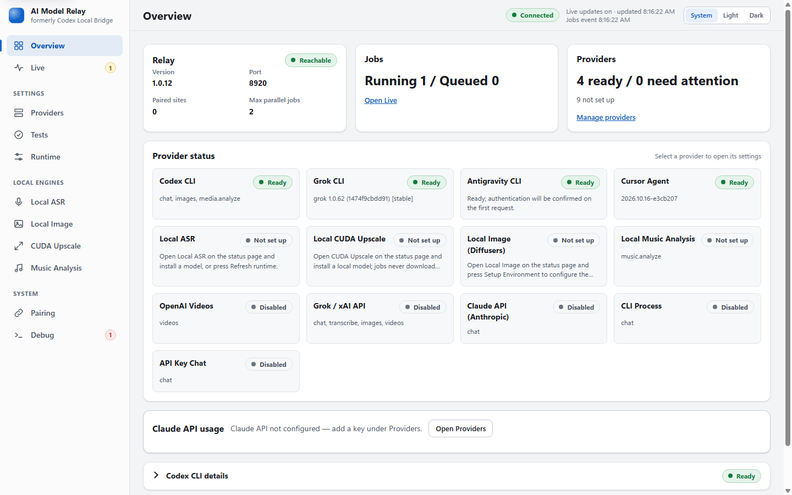
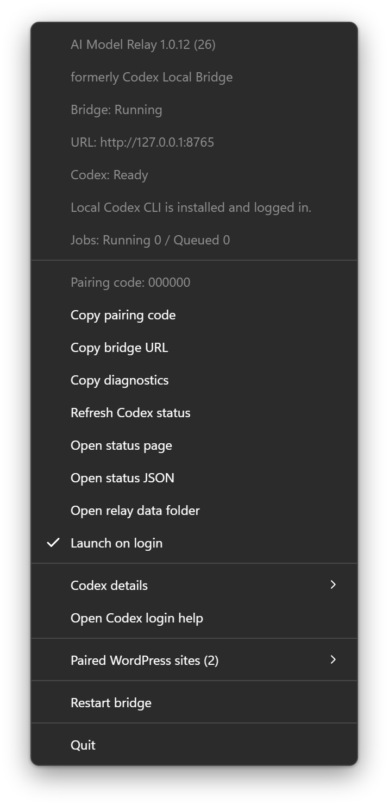

# Operations

## User Installation

1. Install the CLI or local runtime for the operations you intend to use, under the same Windows account that will run the tray app.
2. Sign in to each CLI that requires it, for example `codex login` or the Grok CLI's own login flow.
3. Install or unzip the latest AI Model Relay release. Existing installer artifacts may still use the Codex Local Bridge name during the compatibility transition.
4. Start `AI Model Relay` and open its `/status` page.
5. Open **Providers** in the status page sidebar, press **Refresh detection**, and wait for the provider cards to finish their background checks.
6. Choose ready providers in the **Routing** card (below the provider cards) for the relay operations you need, then press **Save changes**.
7. In WordPress, enable the applicable local bridge integration and keep the bridge URL at `http://127.0.0.1:8765` unless a custom port is required.
8. Pair the WordPress origin with the six digit tray code when prompted.

## Status Page Navigation

The status page (`/status`) has a fixed left sidebar: **Overview**, **Live**, **Providers**, **Tests**, **Runtime**, **Local ASR**, **Local Image**, **CUDA Upscale**, **Music Analysis**, **Pairing**, and **Debug**. Under 900 px wide the sidebar becomes a menu (button at the top left). The page follows the system light or dark setting; the **System / Light / Dark** toggle in the header overrides it and is remembered in the browser (local storage; if the browser blocks storage the choice simply is not remembered).

- Sidebar badges: **Live** shows the running plus queued job count, **Debug** shows the number of recent failed jobs, and a dot on **Providers**, **Runtime**, **Local ASR**, **Local Image**, **CUDA Upscale**, or **Music Analysis** means that page has unsaved changes. Navigating away never discards edits; the forms stay in place.
- Every page is a hash route you can bookmark: `#overview`, `#live`, `#live/<request id>` (selects that job), `#providers` and `#providers/<provider id>` (opens and highlights that provider's card), `#tests`, `#tests/<chat|image|video|analysis|audio>`, `#tests/<type>/<provider id>` (selects the test type and highlights that provider's test cards; if the provider has no ready test of that type, a note says so), `#runtime`, `#asr`, `#image`, `#upscale`, `#music`, `#pairing`, and `#debug`. Older `#settings/<section>` links still open the matching page.
- The header pill shows how the page gets updates: **Connected** (the live event stream is healthy), **Polling fallback** (stream unavailable, status polled every 5 s while the stream is retried automatically after 2, 4, 8, 16, then every 30 seconds), **Status delayed** (a status request failed; the last good state stays on screen and the time of the last update is shown), or **Relay unreachable** (after 3 failed polls in a row or 30 s of failures, or immediately if nothing was loaded yet, for example while the Relay restarts). The Relay sends a heartbeat every 15 s; if the stream stays open but delivers nothing for about 35 s it is considered stalled, closed, and the page falls back to polling (and retries the stream) so the states above follow the polls. The Overview **Relay** pill says **Reachable** as soon as the Relay answers, even while the Codex check is still running; the Codex pill shows **Checking…** until that check finishes.
- The settings pages (Providers, Runtime, Local ASR, Local Image, CUDA Upscale, Music Analysis) share one save model: a sticky **Save changes / Discard** bar appears at the bottom only while the page differs from the last loaded settings. A value that was already stored out of range and is left untouched shows a non-blocking warning ("Stored value is outside the supported range and will be clamped by the Relay.") and does not block saving; a newly edited invalid value blocks Save and is explained next to the field.

### Status page screenshots

Example status page (Overview, light theme; the screenshots are anonymized, so user name, home path, host name, and e-mail addresses are replaced):



More views live next to it in `docs/images/`: `overview-light.png`, `providers-dark.png` (Codex CLI card expanded), `tests-light.png` (Chat tests), `live-dark.png` (job inspector), and `status-page-mobile.png` (390 px wide window). `status-page.png` is a copy of `overview-light.png`. The jobs shown in the Live and Overview screenshots are illustrative demo entries, not real requests.

To regenerate them, run the capture script with Electron from a checkout that has `node_modules` installed:

```powershell
npm run screenshots
# or, with an explicit Electron binary:
node_modules\.bin\electron scripts/capture-screenshots.js --out docs/images
```

The script starts a temporary Relay on a free port (from 8920) with a fresh, empty state directory under the system temp folder, so your real pairings, API keys, and settings are never used or shown (API-key style environment variables are also removed from that process). It renders each page in a hidden window, anonymizes the text, attributes, and input values in the page, fails if the user name, home path, host name, or an e-mail address is still present, writes the PNGs, and deletes the temporary directory. Provider detection reflects the machine it runs on (installed CLIs and versions), so check the images before committing them. Options: `--out <dir>`, `--port <number>`, `--only <name,name>`, `--no-demo-jobs`, and `--keep-temp`.

`tray-menu.png` is not a screen capture: native tray menus cannot be captured headlessly, so the script renders a replica of the Windows 11 dark context menu in a hidden window (transparent background, drawn at 2x). The menu entries are built by the real template function in `src/tray-menu.js`, the same one `src/main.js` uses for the tray, and filled with demo values (placeholder pairing code `000000`, example sites, `Bridge: Running`, `Codex: Ready`). Only the look (fonts, spacing, colors) is imitated; the labels come from the shared template, and `test/tray-menu.test.js` pins their order. The PNG itself is a static snapshot, so regenerate it after any tray label change. Regenerate just this image with `--only tray-menu` (it needs no Relay data).

## Providers and Model Routing

The **Providers** page shows one expandable card for every supported local/API driver with an installed, ready, checking, not-authenticated, or unavailable state; executable path, version, supported operations, and concise safe diagnostics are shown separately so long paths do not distort the card layout.

- **Codex CLI**: chat, image generation, and media analysis. Chat uses stdin plus `--ephemeral` and, when advertised, `--sandbox read-only`. Image jobs use the saved relay setting `codex_image_tool` (`image_gen` or `generations`). Omitted, blank, or invalid means `image_gen`. An explicit stored `generations` stays `generations` until changed. The default `image_gen` path runs `codex exec` and tells the model to pass the request text verbatim as the built-in `image_gen` prompt. Size and quality stay inside that prompt as scene hints for aspect ratio and detail. The built-in tool arguments are only `prompt`, `referenced_image_paths`, and `num_last_images_to_include`. Size, quality, and file format are not tool arguments. The tool returns PNG. Relay publishes size and quality as generation guidance, output format only `image/png`, one candidate, and at most 4 reference images. This path detects new files under `CODEX_HOME/generated_images` (per-thread subdirectories are possible), so those jobs stay serialized to one running image job. Optional `generations` POSTs to the Codex login endpoint `images/generations`, or `images/edits` when reference images are present, using the existing `codex login` session in `CODEX_HOME/auth.json`. The model on that body is `gpt-image-2.5-sunburst`. It does not use `OPENAI_API_KEY` or `image_gen.py`. The body may include prompt, size, quality, and output format, but the Codex login endpoint does not apply size or quality. The published contract matches `image_gen`. `generations` returns image bytes and does not scan `generated_images`.
- **Grok CLI**: isolated Gateway chat (`--prompt-file` / `--prompt-json`, no shell/subagents/web search) plus Grok Imagine image generation and experimental image-reference video generation only when `%USERPROFILE%\.grok\skills\imagine\SKILL.md` or `%USERPROFILE%\.grok\bundled\skills\imagine\SKILL.md` declares the matching local tools. Imagine allowlists one tool per request.
- **Cursor Agent**: Gateway chat through `cursor-agent --print --output-format json --mode=ask --trust` in a temp workspace. The transcript is in `prompt.txt`, not on argv.
- **Antigravity CLI**: chat, images (`IMAGE_PATH:` import with state-root fallback), and media analysis through authenticated `agy`.
- **CLI Process**: any command-line tool as a chat backend; the prompt is sent on stdin.
- **Claude API (Anthropic)**: chat with optional images through an API key (`model-relay:anthropic:*`). The **Overview** page shows the usage panel (credits estimate, month-to-date spend, rate limits).
- **Grok / xAI API**: chat, Imagine image, Imagine video, and Speech-to-Text with one `XAI_API_KEY`.
- **API Key Chat**: any OpenAI-compatible `/chat/completions` endpoint, configured with base URL, key, and model.
- **OpenAI Videos**: opt-in Sora 2 video driver. OpenAI scheduled Sora 2 and the Videos API for removal on 24 Sep 2026; prefer xAI Imagine video.
- **Local ASR**, **Local Image**, **Local CUDA Upscale**, **Local Music Analysis**: engines on this computer, each with its own sidebar page for setup and settings.

HTTP chat bodies (xAI, API Key Chat) include the resolved `max_tokens` / `max_completion_tokens`. Every environment variable is listed in [Configuration](configuration.md).

The selectors in the **Routing** card route only `/v1/relay/jobs/*`: chat, images, videos, transcription, media analysis, and music analysis. Explicit `payload.model`, `payload.provider`, or `payload.backend` always overrides the saved default. Legacy `/v1/chat`, `/v1/images`, `/v1/transcribe`, `/v1/videos`, and `/v1/media/analyze` remain unchanged for provider routing.

The status page settings are the primary operator control. Use **Providers** (cards with CLI paths, API keys, models, extra CLI options, plus the **Routing** card for default models and token defaults), **Runtime** (concurrency and timeouts), **CUDA Upscale**, **Music Analysis**, **Local Image**, and **Local ASR** in the sidebar. A non-empty saved value wins; leave a field blank to keep the matching environment variable or code default. API keys are stored in the local state file, returned only as `configured` plus a 4-character suffix, and can be cleared so environment variables apply again: a saved key shows "Saved key ends with ..." with **Replace** and **Clear** buttons, and the key itself is never sent back to the page. The listen port (`ALORBACH_CODEX_BRIDGE_PORT`) and state directory remain process-start environment settings and are shown read-only on the Runtime page.

**Tests** (sidebar) is a segmented control with **Chat**, **Image**, **Video**, **Video analysis**, and **Audio** (arrow keys, Home and End move between them; each shows how many tests it holds). It starts on **Chat**, which lists every ready chat model across CLI drivers (Codex, Grok, Cursor Agent, Antigravity, CLI Process) and API drivers (Claude API, Grok / xAI API, API-key chat). Each card sends one real, single-turn request (test prompt, optional system prompt, optional image (PNG, JPEG, or WebP; GIF is accepted only for API providers, CLI providers receive the image as a local file reference so check that the reply actually describes it, and CLI Process takes no images), and a small `max_tokens`, default 256) through `POST /v1/relay/test` with `job_type: "chat"` and shows the reply, resolved model, elapsed time, token usage, and finish reason, or the error with its code and HTTP status. The test also appears in the Live view. Chat tests are real requests: provider usage or API charges may apply, and a model that is not ready fails with a configuration error instead of falling back to another provider. **Run all chat tests** sits in a summary bar at the top of the Chat tab: it runs the visible cards one at a time (never in parallel), shows live progress (`Running 2 of 5 ...`) and finishes with colored passed / failed / without-reply counts, and can be cancelled: Cancel takes effect immediately, a test that is already running keeps running and can be followed in Live, and the remaining tests are not started. Use it to verify a freshly entered API key or a newly installed CLI without a WordPress Gateway job.

In the **Routing** card on **Providers**, optional **Chat token default** (code default 8192) and **Media analysis token default** (code default 4096) override those floors when set to an integer from 512 to 128000. Leave them blank to keep the code defaults. Client `max_tokens` values of 512 or higher still win for that job. These token fields apply to legacy chat/analysis routes as well as relay jobs.

The relay never silently falls back. If an explicit or saved model/provider is unknown, unavailable, unauthenticated, disabled, or incompatible with the job type, the request fails with a configuration error naming that choice. An unavailable saved selection remains visible but disabled in the Routing card so it can be corrected.

## Development Commands

Install dependencies:

```powershell
npm ci
```

Run tests:

```powershell
npm test
```

Run the server without Electron:

```powershell
npm run serve
```

Run the tray app:

```powershell
npm start
```

Limit local Codex parallelism for a development run. Prefer **Runtime → Max concurrent jobs**; the environment variable applies only when that field is blank:

```powershell
$env:ALORBACH_CODEX_MAX_CONCURRENT_JOBS = '2'
npm start
```

Run the standalone HTTP example:

```powershell
npm run example:http
```

Check the legacy Codex smoke path:

```powershell
npm run smoke
```

The normal status page load is immediate: provider discovery uses cached diagnostics while Codex, Grok, and Cursor are checked in the background. Open **Providers** and press **Refresh detection** to start a new background provider check. If you edited executable paths, only those paths are saved first (other pending edits such as typed API keys or routing stay unsaved until you press **Save changes**). Check Local ASR runtime separately by pressing **Refresh runtime** on the Local ASR page; that explicit action may run Python, ffmpeg, GPU, or CUDA checks.

Generate icons:

```powershell
npm run icons
```

Build Windows artifacts:

```powershell
npm run dist:win
```

## Build Outputs

Windows builds are written to `dist/`.

Release artifact names include the semantic version and build number:

```text
AI-Model-Relay-<version>-build.<number>-win-x64.exe
AI-Model-Relay-<version>-build.<number>-win-x64.zip
```

Local builds increment `.build/build-number`. GitHub Actions builds use `GITHUB_RUN_NUMBER`.

## Release

Push a version tag:

```powershell
git tag v<version>
git push origin v<version>
```

The release workflow:

1. checks out the repo;
2. derives the package version from the tag;
3. installs Node dependencies;
4. generates icons;
5. syntax-checks JavaScript files;
6. runs tests;
7. builds the Windows installer and portable ZIP;
8. writes a user-facing changelog from the commit subjects since the previous tag with GitHub Copilot CLI, when the `COPILOT_GITHUB_TOKEN` secret is set;
9. generates a release description with download names, validation context, and the Copilot changelog, or GitHub's generated change entries when the token is missing or the Copilot step fails;
10. removes older installer and ZIP assets from an existing release for the same tag;
11. publishes a GitHub Release with that description and only the current build's installer and portable ZIP assets.

To enable the Copilot changelog, create a fine-grained personal access token with the **Copilot Requests** permission (the account needs an active Copilot plan; each release uses its Copilot requests) and store it as the repository secret `COPILOT_GITHUB_TOKEN`. The Copilot step runs in an empty directory with no tools approved, so it only sees the commit subjects.

## Diagnostics

Use the tray menu:



- double-clicking the tray icon opens `/status`;
- `Open status page` opens `/status`;
- `Open status JSON` opens `/v1/status`;
- `Copy diagnostics` copies a JSON diagnostic payload without bearer token values;
- `Open relay data folder` opens the relay state directory: `AI_MODEL_RELAY_STATE_DIR` / `ALORBACH_MODEL_RELAY_STATE_DIR` if set, otherwise `%USERPROFILE%\.ai-model-relay` if it already exists, otherwise the legacy `%USERPROFILE%\.alorbach-codex-bridge`;
- `Refresh Codex status` rechecks legacy Codex status. For all providers, use **Providers → Refresh detection**, which starts an asynchronous cached refresh.

The tray icon animates while jobs are running and changes color for queued, failed, and stopped states. Mouse-over text and the tray menu show running and queued job counts plus request IDs, job types, models, and elapsed time. The status page's **Live** view lists each job with a status pill (running, queued, completed, failed, cancelled), provider, model, type, and elapsed time; filter it by status or job type or search it, and select a job to see the selected provider/API, workflow/skill, bounded redacted stdin, and bounded stdout/stderr/session output. It retains recent generated image thumbnails; click one to inspect it in an overlay without opening a new tab. Session input and output are shown in a monospace block with a **Wrap lines** toggle, a **Copy** button, and (while the job runs) an **Auto-scroll** toggle; error details of a failed job are listed first. The **Debug** page lists health checks with a summary, recent failed jobs as expandable rows, detected features, backend drivers, paired sites, and Codex details; its raw status JSON is collapsed by default (open it to filter or copy it).

Failed bridge requests include a `debug_help` object in the JSON response. It points to `/status`, `/v1/status`, the request id when available, and safe checks such as provider readiness, pairing state, and tray diagnostics. The `/status` page uses a local job event stream to append bounded live session input/output for running jobs, then keeps recent failed jobs with safe stdout/stderr/last response text when available.

Full-fidelity temporary model debug logs are written under `%TEMP%\alorbach-codex-local-bridge-debug`. The bridge deletes that directory on startup. Each invocation gets its own folder with `prompt.txt`, `output.txt`, `stdout.txt`, `stderr.txt`, and `metadata.json`. These files are intentionally not redacted, so treat them as private local diagnostics.

Useful direct checks:

```powershell
codex --version
codex login status
npm run smoke
```

If the app resolves the wrong Codex command on Windows, set the Codex executable on the Codex CLI card under **Providers**, or use the environment variable when that field is blank:

```powershell
$env:ALORBACH_CODEX_BINARY = '<path-to-codex.exe>'
npm start
```

## Local ASR

Local ASR transcription/alignment is optional and private to the user's machine. The bridge supports faster-whisper models through Python 3.10 and Qwen3 ASR/ForcedAligner through a separate Python environment. Both providers use cached Hugging Face model snapshots or explicitly enabled model downloads.

Default behavior:

- Whisper Python is auto-detected, preferring `%LOCALAPPDATA%\Programs\Python\Python310\python.exe`.
- Qwen Python is auto-detected, preferring `%LOCALAPPDATA%\Programs\Python\Python312\python.exe`.
- The Whisper ASR virtual environment is `%USERPROFILE%\.alorbach-codex-bridge\asr-venv` unless `ALORBACH_ASR_VENV` is set.
- The Qwen ASR virtual environment is `%USERPROFILE%\.alorbach-codex-bridge\qwen-asr-venv` unless `ALORBACH_QWEN_ASR_VENV` is set.
- Package installation happens only from the status-page **Install model** action; transcription jobs do not pip-install packages.
- Model downloads during jobs stay disabled by default; use cached model snapshots or set a local model path unless downloads are explicitly enabled in `/status`. Setup still downloads models when you click Install model.
- Requests that omit `payload.model` use the `Default model` from the **Local ASR** page when set; otherwise `local-asr` auto-selects the best ready transcription model. A caller-supplied `payload.model` always overrides the default.
- Qwen Install uninstalls any existing CPU PyTorch wheel, installs CUDA `torch`/`torchvision` from `ALORBACH_QWEN_TORCH_INDEX_URL` only, pins the wheel with `cuda-torch-constraint.txt`, then installs `qwen-asr` and `huggingface_hub`. A second CUDA probe rejects CPU wheels that slip in via dependencies. Jobs never repair a broken torch install.
- Whisper CUDA is selected only when the enabled model prefers it, enough free VRAM is detected, and CUDA runtime packages are usable. A CUDA load failure falls back to CPU/int8 when possible.
- Qwen3 ASR requires CUDA, but can optionally use mixed GPU/CPU loading through Transformers `device_map="auto"` when a selected Qwen model does not fit fully in VRAM. The bridge still prefers a fully GPU-ready transcription model during automatic selection; use the 0.6B model for normal low-VRAM work and explicit/default 1.7B selection when CPU offload is acceptable.
- Qwen timestamp output still requires `Qwen/Qwen3-ForcedAligner-0.6B` to be cached or explicitly downloadable, but the ForcedAligner is not exposed as a normal transcription model because it requires reference text.
- Qwen timestamped transcription is pre-chunked locally before ASR and alignment. The default chunk size is 30 seconds to avoid long ASR omissions inside Qwen's larger timestamp chunks. The bridge also reports and caps implausibly stretched single-word timestamps.

Useful environment overrides (used when the matching field on the **Local ASR** page is blank):

```powershell
$env:ALORBACH_ASR_PYTHON = 'C:\Users\<you>\AppData\Local\Programs\Python\Python310\python.exe'
$env:ALORBACH_ASR_VENV = 'C:\Users\<you>\.alorbach-codex-bridge\asr-venv'
$env:ALORBACH_QWEN_ASR_PYTHON = 'C:\Users\<you>\AppData\Local\Programs\Python\Python312\python.exe'
$env:ALORBACH_QWEN_ASR_VENV = 'C:\Users\<you>\.alorbach-codex-bridge\qwen-asr-venv'
$env:ALORBACH_QWEN_TORCH_INDEX_URL = 'https://download.pytorch.org/whl/cu128'
$env:ALORBACH_QWEN_ALLOW_CPU_OFFLOAD = '1'
$env:ALORBACH_QWEN_CHUNK_SECONDS = '30'
$env:ALORBACH_QWEN_MAX_WORD_DURATION_SECONDS = '12'
$env:ALORBACH_ASR_DEFAULT_MODEL = 'qwen3-asr-0.6b'
$env:ALORBACH_ASR_CPU_THREADS = '4'
$env:ALORBACH_ASR_TRANSCRIBE_TIMEOUT_MS = '1800000'
$env:ALORBACH_ASR_PROBE_TTL_MS = '30000'
$env:ALORBACH_ASR_CUDA_PATHS = '<extra-cuda-bin-paths>'
npm start
```

If Local ASR setup is slow, check the job output in `/status`. The large downloads are usually Python wheels such as `ctranslate2`, `onnxruntime`, `av`, Qwen/vLLM dependencies, CUDA runtime packages, or the selected ASR model when model downloads are enabled.

## Local Music Analysis

The **Music Analysis** page sets up a separate local pipeline for acoustic album metrics. Its setup button creates `<state dir>\music-analysis-venv` and installs `numpy`, `scipy`, `soundfile`, `librosa`, and `pyloudnorm` only when you ask for it (Python 3.10+ and ffmpeg/ffprobe on `PATH` are required). It returns tempo and beat grid, key estimate, loudness, spectral descriptors, and neutral numbered sections. It does not separate stems, recognize chords, extract melody or MIDI, infer lyrics, or send audio to a cloud provider.

## Local Image

The **Local Image** page installs and configures local GPU image models (Qwen-Image 2.1 and 2512, FLUX.2-dev NF4, NVIDIA Sana 1.6B, Ideogram 4.0 GGUF) into `<state dir>\qwen-image-venv`. Models are downloaded only by the explicit install action; image jobs (`model-relay:local-image:*`) never download anything and never send pixels to a cloud provider.

## Local CUDA Upscale

The **CUDA Upscale** page shows one card per model: SwinIR ×2, Real-ESRGAN ×2plus/×4plus, HAT-S ×2/×4, DRCT ×2/×4, and APISR ×2. Real-ESRGAN ×4plus is marked as recommended for ×4, including before installation. Setup is an explicit operator action: it clones the pinned official checkout, downloads the pinned weight where one is published, installs CUDA PyTorch into the BasicSR `upscale-venv` or the isolated APISR runtime, and verifies the weight SHA-256. If setup fails, pip and Python output is shown below the model cards. DRCT ×2 stays unavailable until an operator supplies a separately verified checkpoint, because no official ×2 release exists. APISR needs an explicit GPL-3.0 / academic-only acknowledgement.

Jobs never download a model, never send pixels to a cloud provider, and never fall back to CPU. A request with `scale: 4` and no model selects Real-ESRGAN ×4plus; it still requires prior setup. An explicitly selected model remains in effect. Only one upscale job runs per GPU, and free VRAM is reported before it starts. The Relay returns the model's native output only: ×2 requires `scale: 2` / `retain_native_x2`, ×4 requires `scale: 4` / `retain_native_x4`, with exact crop-derived dimensions. It never downsamples or synthesizes ×2 from ×4 (provenance reports `downsampler: none`). Native ×4 PNG output is capped at 256 MiB.

BuchWerk uses this for its local KDP upscale: the paired BuchWerk page sends a signed binary image to `POST /v1/relay/jobs/upscale` after the user reviewed and approved a KDP crop (**KDP first + local CUDA ×2**). The result is a new candidate asset; the original is never modified.

## Common Failures

### Bridge not reachable

Check that the tray app is running and that no other process owns the configured port. The bridge binds only to `127.0.0.1`.

### Provider is installed but not ready

Open **Providers**, press **Refresh detection**, and read the provider card's safe diagnostic. Sign in from the same Windows account as the tray app (for example, `codex login` for Codex) and refresh again. The bridge does not use another provider as a fallback.

### Grok image or video is unavailable

Grok CLI media requires `%USERPROFILE%\.grok\skills\imagine\SKILL.md` or `%USERPROFILE%\.grok\bundled\skills\imagine\SKILL.md` to declare the relevant Imagine tools. Press **Refresh detection** after installing/updating Grok. Image/video jobs fail explicitly when the Imagine tools are unavailable, no output artifact is generated, the request is moderated, or the bounded Grok process times out. Video remains experimental until a local video request succeeds; if Grok confirms that a video tool is unavailable, refresh detection and update Grok before selecting it again.

xAI Imagine HTTP image and video jobs (`model-relay:xai:imagine-image`, `model-relay:xai:imagine-video`) need an xAI API key on the Grok / xAI API card under **Providers** or `XAI_API_KEY` / `AI_MODEL_RELAY_XAI_API_KEY` when that field is blank. Native image fields remain the existing aspect ratios (including `21:9` and `5:2`) and native resolution `1k`/`2k`. Image `quality` is `low`, `medium`, or explicit `auto`; omitting `quality` leaves the provider default. Image jobs accept up to 5 reference images and `n` from 1 to 10. The image API returns JPEG only: the relay accepts `image/jpeg`, normalizes an omitted `output_format` to `image/jpeg`, and rejects `png`, `webp`, and other formats. `response_format` stays `b64_json` and is not a file format. Video fields remain resolution `480p`/`720p`/`1080p`, clip length 1–15 seconds, and `generate_audio`. These upload the prompt and any reference images to xAI. When that key is set and no video default has been saved, Settings defaults video routing to Imagine video.

Claude API (Anthropic) chat (`model-relay:anthropic:*`) needs an API key on the Claude API card under **Providers** or `ANTHROPIC_API_KEY` / `AI_MODEL_RELAY_ANTHROPIC_API_KEY` when that field is blank. The optional Admin API key (`ANTHROPIC_ADMIN_KEY` / `AI_MODEL_RELAY_ANTHROPIC_ADMIN_KEY`) only enables month-to-date spend on the Claude API usage card; the credit figure is an estimate: remaining credits = the saved balance minus Cost API spend from the start of the UTC day the balance was saved (daily granularity, about 5 minutes of lag, excludes Priority Tier). The usage panel is shown in full on the **Overview** page and as a compact summary inside the Claude API card on **Providers**. Use "Recount spend from today" on the Claude API card to re-baseline an unchanged balance. Refusal fallbacks for Opus 5.5, Opus 5, Sonnet 5.5, and Fable 5.1 are sent only when calling api.anthropic.com directly (not through a custom base URL) and can be disabled with `AI_MODEL_RELAY_ANTHROPIC_FALLBACKS=0`.

### Image resolution expectations on status-page tests

Codex image tests follow `codex_image_tool`. Omitted, blank, or invalid means `image_gen`. An explicit stored `generations` stays `generations` until changed. The default `image_gen` path puts size and quality inside the verbatim built-in `image_gen` prompt as scene hints. The tool has no size, quality, or file-format argument and returns PNG, so Relay publishes size and quality as generation guidance and the only output format as `image/png`. Measured results stay about 1.57 megapixels. Aspect ratio can follow the prompt text. Pixel size is not guaranteed. Labels for the larger presets stay "requested, not guaranteed". Optional `generations` may include prompt, size, quality, and output format on the Codex login body, but that endpoint does not apply size or quality. Its published contract matches `image_gen`. Grok CLI passes `aspect_ratio` as an `image_gen` / `image_edit` tool argument. It has no resolution or quality control, and the only output format is `image/jpeg`. Prompt hints for 1K, 2K, PNG, or WebP do not change the file. Grok CLI video passes `resolution_name` `480p` or `720p` and `duration` `6` or `10` as tool arguments. It has no `1080p` and no soundtrack switch. `aspect_ratio` goes to `reference_to_video` and to a generated source image, not to `image_to_video`. A Grok `image_edit` with one reference keeps that source canvas; when the requested ratio differs, Relay duplicates the reference so Imagine applies `aspect_ratio` as a multi-image edit. Antigravity `generate_image` accepts `prompt`, `imageName`, at most 3 `imagePaths`, and `aspectRatio` (`1:1`, `2:3`, `3:2`, `3:4`, `4:3`, `9:16`, `16:9`). It returns one JPEG at about 1 megapixel. `imageSize` and `output_format` are not tool arguments. The Live view shows the measured artifact width × height so you can compare a requested size against what the provider actually returned. xAI Imagine HTTP (`model-relay:xai:imagine-image`) sends `resolution` `1k`/`2k` natively. Codex size and quality are guidance, and the only output format is `image/png`.

### Cursor Agent is unavailable

Install Cursor Agent so `cursor-agent` is resolvable for the tray-app Windows user, authenticate it if required, then use **Refresh detection**. The bridge intentionally does not probe the generic `agent` command because it can refer to Grok's bundled executable.

### Pairing fails

Confirm the browser page is served from `http` or `https`, not `file://`. Pairing is origin-based, so `http://localhost:8787` and `http://127.0.0.1:8787` are different origins.

### Requests return 403 after pairing

Clear the browser's stored token for the origin and pair again. Also check the tray menu for the paired origins list.

### Image request succeeds in Codex but bridge returns no image

This applies to the default `codex_image_tool` value `image_gen`. That path detects new files under `CODEX_HOME\generated_images` (per-thread subdirectories are possible). Confirm Codex writes generated images there for the current `CODEX_HOME`. Optional `generations` returns image bytes from the Codex login endpoint and does not scan that directory.

Jobs stay serialized to one running image job because `image_gen` detection uses the shared generated-images directory. Chat jobs may still run beside an image job up to the **Runtime** page's concurrency value, or `ALORBACH_CODEX_MAX_CONCURRENT_JOBS` when that field is blank.

### WordPress retry says duplicate request

The browser likely created a Gateway job and failed before calling `/fail`. The Gateway duplicate lock expires with the local job TTL, currently 900 seconds.

### Local ASR shows not checked

This is expected on initial `/status` load. Press **Refresh runtime** on the **Local ASR** page to run the full runtime probe. Provider detection and the normal page load remain cached so bridge and job diagnostics render immediately.

### Local Whisper says Python or faster-whisper is missing

Install Python 3.10 for the same Windows account or set `ALORBACH_ASR_PYTHON`. Use **Install model** on the status page to create the Whisper venv and install `faster-whisper`, `huggingface_hub`, and CUDA runtime packages. Transcription jobs do not pip-install.

### Local Whisper model is missing

Either use **Install model** on the status page or configure `local_path` for an existing faster-whisper/CTranslate2 model snapshot. The default faster-whisper model list includes Large v3, Medium, and Small.

### Local Qwen ASR model or aligner is missing

Either use **Install model** on the status page or configure `local_path` for `Qwen/Qwen3-ASR-1.7B` or `Qwen/Qwen3-ASR-0.6B`, plus `aligner_local_path` for `Qwen/Qwen3-ForcedAligner-0.6B`. Job-time downloads stay disabled by default so Qwen remains fully local after Install caches the snapshots.

### Local Qwen ASR has less free VRAM than the selected model requires

Use `qwen3-asr-0.6b` as the default model for normal low-VRAM transcription. If you explicitly need `qwen3-asr-1.7b`, enable `Allow Qwen CPU offload` in `/status`; the bridge will load Qwen with `device_map="auto"` and use CPU RAM for layers that do not fit in VRAM. This can be much slower than the full-GPU path and may still fail if system RAM is constrained.

### Local Qwen ASR says preprocessor_config.json is missing

The Hugging Face cache snapshot is incomplete. Qwen ASR snapshots must include processor/tokenizer files such as `preprocessor_config.json`, `tokenizer_config.json`, `vocab.json`, and `merges.txt`, not only the safetensors weights. Use **Install model** again so setup can verify and redownload missing files, or remove the incomplete snapshot under `%USERPROFILE%\.cache\huggingface\hub\models--Qwen--...`.

### Local Qwen ASR says Torch not compiled with CUDA enabled or shows a CPU torch wheel

Press **Refresh runtime** on the **Local ASR** page and check `Qwen torch CUDA`. Use **Install model** on a Qwen ASR entry; setup uninstalls CPU PyTorch wheels, installs CUDA builds from `ALORBACH_QWEN_TORCH_INDEX_URL` (default cu128 index only), pins torch before `qwen-asr`, and fails if a `+cpu` wheel remains. Transcription jobs do not repair torch at job time.

### CUDA runtime is missing or unusable

Use **Refresh runtime** on the **Local ASR** page to see the exact CUDA reason. Whisper **Install model** installs `nvidia-cublas-cu12` and `nvidia-cudnn-cu12` into the ASR venv. Jobs do not install CUDA runtime packages; if CUDA still fails during transcription, the job retries on CPU/int8 when a CPU model is available.

## Naming and Compatibility

The product was originally released as **Codex Local Bridge** and has been renamed to **AI Model Relay**.

### What the rename changed

- The tray app title, window title, and About text now read **AI Model Relay**.
- The product name and short name returned by `/v1/status` and `/v1/capabilities` are `AI Model Relay` and `Model Relay`. The field `legacy_name` in those responses still returns `Codex Local Bridge`.
- Local ASR model IDs now use the `local-asr:*` prefix (e.g. `local-asr:whisper-large-v3`, `local-asr:qwen3-asr-0.6b`). The previous `codex-local:audio:*` prefix is accepted as a compatibility alias for stale clients.
- Provider-neutral relay model IDs use the `model-relay:<backend>:<model>` form (e.g. `model-relay:local-asr:qwen3-asr-0.6b`, `model-relay:xai:grok-4.6`). These were introduced alongside the rename and have no legacy equivalent.

### What remains unchanged

- The default bridge URL and port: `http://127.0.0.1:8765`.
- The legacy `/v1` HTTP routes: `/v1/status`, `/v1/capabilities`, `/v1/chat`, `/v1/images`, `/v1/transcribe`, `/v1/videos`, `/v1/media/analyze`, `/v1/models`, `/v1/pair`, `/v1/unpair`, and `/v1/asr/settings`. The additive relay routes live under `/v1/relay/*`.
- Text and image model IDs: `codex-local:auto`, `codex-local:image`, and any `codex-local:<id>` IDs from `models_cache.json`.
- The user state directory: `%USERPROFILE%\.alorbach-codex-bridge`.
- The bridge process name, tray binary name, and installer package ID used by existing WordPress plugins.
- All signed job envelope fields (`job_token`, `request_hash`, `request_id`) and the pairing token header.

### Installer artifacts

Installer builds produced before the rename may still display the Codex Local Bridge name in Windows Add/Remove Programs and in the installer wizard. The underlying bridge URL, state directory, and API are identical.
